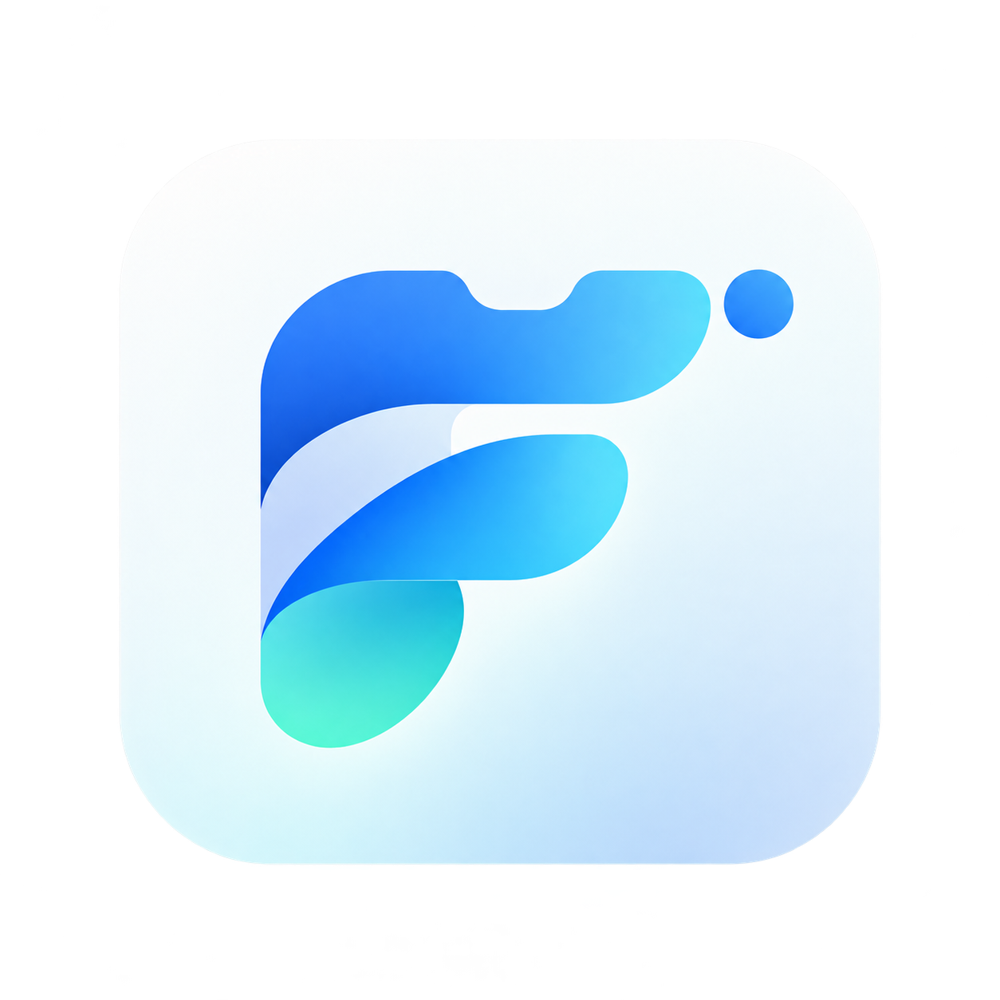
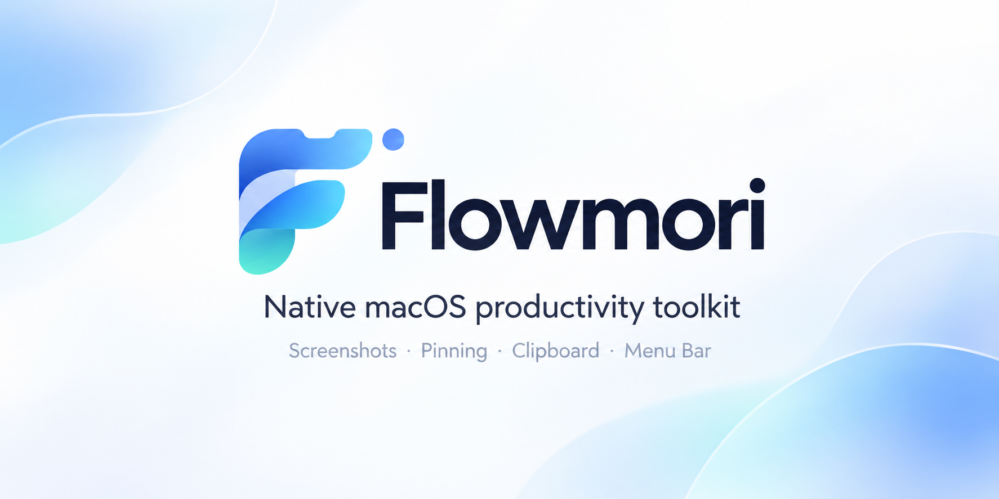

<p align="center">
  
</p>

# Flowmori

[English](README.md) | [简体中文](README_CN.md)

A native macOS menu bar app for clipboard history, annotated screenshots, floating image pins, and menu bar organization. Built with Swift, AppKit, and SwiftUI. Your data stays on your Mac.

<p align="center">
  
</p>

## Features

- **Clipboard history:** Search, favorite, and copy saved text and images. Pause recording or exclude apps. Keeps 500 regular entries by default; favorites are retained.
- **Screenshots:** Select an area, resize it, and annotate with rectangles, straight lines, arrows, text, freehand drawing, or mosaic strokes. Copy, save, or pin the result from the capture toolbar.
- **Image pins:** Keep clipboard images and rendered text floating on screen. Move and resize multiple pins, then copy, save, hide, or close them.
- **Menu bar organization:** Collect supported app icons into a panel while keeping system items visible. Access supported menus and popovers from the panel.

After selecting a screenshot region, choose the line tool and drag to draw a straight line. Adjust its color and width, or use the selection tool to move it and adjust its endpoints. Undo and redo are supported.

After selecting a region, press V/R/L/A/T/B/M for selection, rectangle, line, arrow, text, pen, and mosaic. Tool shortcuts pause while entering annotation text. Option+P pins the screenshot at its original position and size, then exits capture.

Outside capture, repeated Option+P presses pin the current clipboard contents followed by history from newest to oldest. Copying new content restarts the sequence; a message appears when history is exhausted. Text becomes a white image with black, wrapped text. Very long text must be split into smaller sections.

Scroll or pinch to resize a pin, double-click to restore its initial size, and Option-scroll to adjust opacity from 20% to 100%. The context menu also provides size and opacity controls.

See the [changelog](CHANGELOG.md) for version changes.

## Install

Requires an **Apple Silicon Mac running macOS 26 or later**. The interface is currently primarily in Simplified Chinese.

1. Download the DMG from [Releases](https://github.com/BaiYu96/flowmori/releases).
2. Open it and drag **Flowmori.app** onto **Applications**.
3. Launch Flowmori from Applications, then eject the disk image. Quit the existing app before replacing it when updating.

Current releases are **early previews**, ad-hoc signed and not Apple notarized. macOS may block the first launch. Only open builds you trust, using the approval options in System Settings → Privacy & Security; do not disable system security protections. Automatic updates are not available.

Menu bar organization is experimental and only enabled on **macOS 26.6.2, build 25G83**. It uses internal system interfaces; other OS builds leave this feature disabled. Display changes wait for layout to settle before collection is checked. Collection startup attempts to recover its own icons when hidden by the notch.

## Quick start

Click the Flowmori menu bar icon to open the collection panel. Right-click it for all tools, Settings, and Quit.

| Default shortcut | Action |
| --- | --- |
| Option + V | Toggle clipboard history near the pointer |
| Option + A | Capture and annotate a screen region |
| Option + P | Pin clipboard contents and successive history entries; pin the current screenshot |
| Option + M | Toggle the menu bar collection panel |

Shortcuts can be changed in Settings. Selecting a history item copies it; press **⌘V** in the destination app to paste. To organize icons, enable the feature in Settings, grant Accessibility access, and click “收纳全部” (Collect All).

New installations enable launch at login by default. You can change this in Settings.

## Permissions and privacy

- **Screen Recording:** Used to capture screenshots and display menu bar icon images. Flowmori does not record audio or microphone input.
- **Accessibility:** Required for menu bar interaction. Clipboard access follows macOS authorization settings.
- **Local storage:** History and images are stored in `~/Library/Application Support/Flowmori/`. No cloud sync, uploads, or telemetry.
- **Sensitive content:** Confidential and temporary clipboard markers are skipped, and some password managers are excluded by default. Unmarked sensitive text cannot be reliably detected; pause recording or exclude its source app as needed.

File copies and copies containing multiple independent objects are not recorded. Each history item is limited to 32 MB. Rebuilding or updating an ad-hoc-signed app may require granting permissions again; run it from a fixed installation location.

Upgrading from MacFlow or an older Flowmori bundle ID? See the [migration notes (Chinese)](docs/MIGRATION.md).

## Build from source

Requires Apple Command Line Tools with Swift 6. No third-party packages are needed.

```sh
bash scripts/build-app.sh release
open dist/Flowmori.app
```

To build, install into `~/Applications`, and launch, quit any running instance first and run `bash scripts/install.sh`.

```sh
# Run tests
bash scripts/swift-command.sh test

# Package the existing signed build as DMG, app ZIP, and source ZIP
bash scripts/package.sh
```

Packaging does not rebuild or re-sign the app. Source archives include only tracked public source files; stage new source files before packaging. See [testing and runtime verification (Chinese)](docs/TESTING.md) for diagnostics and manual checks.

## Feedback and license

Report bugs or request features in [GitHub Issues](https://github.com/BaiYu96/flowmori/issues). For menu bar issues, include your macOS version and build, the affected app, and steps to reproduce.

Licensed under the [MIT License](LICENSE).
