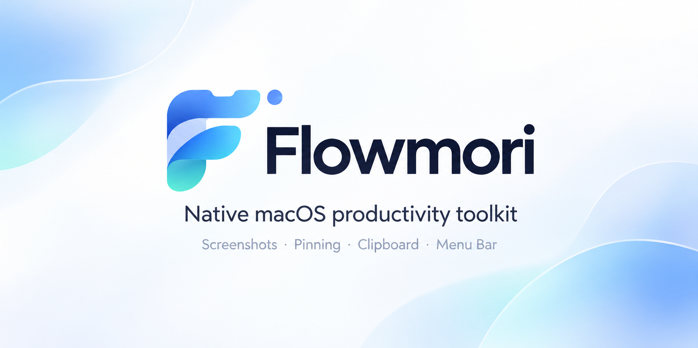

<p align="center">
  
</p>

# Flowmori

原生 macOS 菜单栏工具：截图贴图、剪贴板历史、菜单栏收纳。Swift + AppKit + SwiftUI，数据留在本机，MIT 许可证。

<p align="center">
  
</p>

## 环境

- Apple Silicon Mac，macOS 26。
- 构建需要 Apple Command Line Tools（Swift 6 工具链），不依赖第三方包或完整 Xcode。
- 菜单栏收纳使用动态加载的系统内部接口，目前仅允许 macOS 26.6.2（25G83）；其他构建会暂停收纳，升级后需重新验证。

## 构建与运行

```sh
bash scripts/build-app.sh
open dist/Flowmori.app
```

已验证构建可用 `bash scripts/package.sh` 生成应用 ZIP 与完整源码 ZIP；打包不会重签应用。源码包仅包含 Git 已跟踪的公开源码文件的当前内容；新增源码需先 `git add`，本机笔记和日志不会打入源码包。

安装到当前用户的应用目录并启动：

```sh
bash scripts/install.sh
```

安装脚本在已有 Flowmori 运行时会停止，请先从菜单栏退出应用。也可把 `dist/Flowmori.app` 拖入「应用程序」。建议从固定安装位置运行后再授权、启用登录启动。

应用采用本地 ad-hoc 签名，适合自行构建使用。向他人提供下载版本前需要配置 Developer ID 签名、公证和发行渠道。无需关闭 Gatekeeper 或系统完整性保护。

## 使用

| 快捷键 | 操作 |
| --- | --- |
| Option + V | 在鼠标附近打开／关闭剪贴板历史 |
| Option + A | 框选截图，原位标注后确认复制 |
| Option + P | 将剪贴板图片贴到屏幕 |
| Option + M | 打开／关闭菜单栏收纳面板 |

快捷键可在设置修改。它们会接管相应的 Option 字符输入；冲突时应用显示注册错误，菜单入口始终可用。

- **历史：** 鼠标单击或方向键＋回车复制，面板关闭后在原应用按 ⌘V 粘贴。可搜索、收藏、删除、暂停记录、排除应用。默认保存 500 条普通记录，收藏不自动清理。
- **贴图：** 拖动移动，滚轮／双指缩放，悬停显示复制、保存、关闭按钮；右键也可操作。支持多张贴图。菜单可统一隐藏或关闭。
- **截图：** 框选后拖动选框移动、拖角调整大小；选择矩形、箭头、文字或画笔直接在截图上标注。点“确认”或按 Enter 立即复制到剪贴板和截图历史，不再打开独立标注窗口；保存和贴图仍在同一工具条。
- **收纳：** 先在设置中启用并允许辅助功能。点击「收纳全部」自动整理全部可管理的应用图标，无需寻找或拖动分隔符。保留 Flowmori 入口与时钟、控制中心等系统状态项；待识别图标保持可见，新启动应用识别后自动纳入。点击收纳条目会读取原菜单并显示重建的原生菜单，不移动图标；源应用提供弹窗时直接打开弹窗。右键条目选择「右键操作」。
- **启动：** 首次启动默认注册登录自启动。登录启动不弹窗。应用设置反映系统实际状态；需要批准时会提供提示。
- **菜单：** 左键 Flowmori 图标打开收纳面板；右键打开全部功能、设置和退出。

## 权限与数据

截图需要「屏幕与系统音频录制」中的屏幕读取权限；应用不录制麦克风或音频。菜单栏操作需要辅助功能。剪贴板读取遵循系统授权状态。每项权限可独立授予，拒绝某一项不禁用其他模块。

重新构建会改变 ad-hoc 签名，macOS 可能要求重新授权。请在系统设置移除旧条目，再添加固定安装路径下的新应用；不要修改 TCC 数据库。

数据位置：`~/Library/Application Support/Flowmori/`。历史存于 SQLite，PNG 图片独立存储，清理历史时删除对应文件。默认不联网、不上传、不发送遥测。

### 从旧名称迁移

Flowmori 原名 MacFlow。更新前先在旧版设置中关闭登录启动并退出旧版。首次运行会将旧数据目录整体迁移到 `Flowmori`，包括历史、收藏、图片和恢复日志，并导入快捷键、排除应用等设置。已有 Flowmori 数据不会被覆盖，旧偏好域保留作为迁移来源。

应用标识符为 `ai.flowmori.Flowmori`。从 `app.flowmori.Flowmori` 升级时会导入快捷键、菜单开关、状态栏位置和登录意愿，历史数据目录不变；新标识需要重新授予屏幕录制和辅助功能权限。旧版没有保存自启动意愿时，新版会提示确认登录启动选项；全新安装仍默认开启。迁移完成后可移除旧应用。源码中旧标识仅用于兼容迁移及历史验证记录。

保密、临时及自动生成的剪贴板标记会被跳过，默认排除若干密码管理器。来源应用没有标记的敏感文本无法自动判断，可手动暂停或排除应用。文件复制及包含多个独立对象的复制暂不记录，避免恢复时悄悄丢失对象。单条记录上限 32 MB。

## 验证

```sh
bash scripts/swift-command.sh test
dist/Flowmori.app/Contents/MacOS/Flowmori --diagnose
```

运行状态检查（不读取剪贴板正文）：

```sh
mkdir -p .validation
open dist/Flowmori.app --args --diagnostics "$PWD/.validation/heartbeat.json"
python3 scripts/soak.py --heartbeat "$PWD/.validation/heartbeat.json" --output "$PWD/.validation/soak" --seconds 7200
```

启动检查前需退出已运行实例。两小时检查验证进程、主循环、剪贴板轮询、CPU 和内存；实际权限、截图、菜单操作需另行验收。测试步骤见 [测试与验证](docs/TESTING.md)。

## 品牌素材

- `img/flowmori-hero.png`：主视觉
- `img/flowmori-wordmark.png`：横向标识
- `img/flowmori-logo.png`：透明图形标识
- `img/flowmori-app-icon.png`：应用图标（构建时生成 `AppIcon.icns`）
- `img/flowmori-app-icon-bordered.png`：带边框图标备选
- `img/flowmori-menu-glyph.png`：菜单栏线条标识源图
- `img/flowmori-menu-icon.png`：菜单栏模板图标（从线条标识裁切，20pt）

## 结构

- `FlowmoriCore`：历史存储、过滤规则、坐标换算、菜单操作状态。
- `Flowmori`：原生界面、权限、快捷键、自启动、剪贴板、截图、贴图及菜单栏适配。
- `scripts`：构建、安装、图标生成、连续运行检查。

菜单栏适配代码自主实现，不包含 Ice 的 GPL 代码。Flowmori 不提供公开网络 API。欢迎通过 [GitHub 仓库](https://github.com/BaiYu96/flowmori) 提交问题与改进；当前不提供自动更新。
